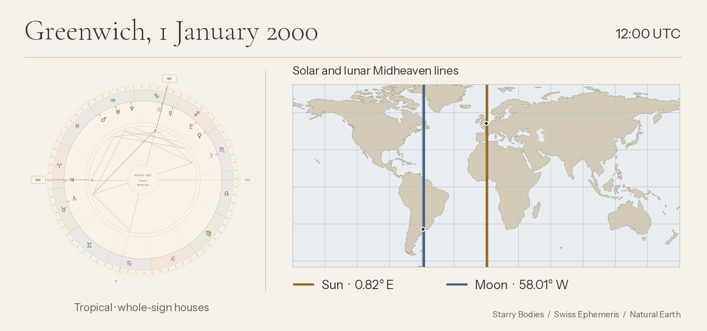

<h1 align="center">
  <a href="https://starrybodies.com/studio">
    <picture>
      <source media="(prefers-color-scheme: dark)" srcset="https://raw.githubusercontent.com/starrybodies/starrybodies/main/assets/celestial-night.jpg">
      
    </picture>
  </a>
</h1>

A birth chart holds a moment still. Astrocartography takes that same moment around the Earth. I built Starry Bodies so you can move between the two, compare charts with someone you love, and see where today’s sky meets your own.

**[Make your birth chart](https://starrybodies.com/studio#birth-heading)** · [See today’s sky](https://starrybodies.com/today) · [Compare two charts](https://starrybodies.com/synastry)

## The sky above Greenwich

At noon UTC on 1 January 2000, the Sun was at 10°22′ Capricorn. It was crossing the local meridian just east of Greenwich. At that same instant, the Moon was crossing the meridian near Buenos Aires. Those two meridians are the gold and blue lines on the map.

To recreate it, enter **1 January 2000**, **12:00 p.m.**, **Greenwich, London, UK** in the studio. Choose the tropical zodiac and whole-sign houses, then switch from **Chart** to **Places**. [Read the illustrated map guide](https://starrybodies.com/learn/read-an-astrocartography-map).

## More from Samu

| Project | What you can try |
| --- | --- |
| [Reword](https://github.com/starrybodies/reword) | Give your coding agent a few pieces you’ve written and teach it to edit in your voice. |
| [Overshoot](https://github.com/starrybodies/overshoot) | Trace a material from extraction to use and open the source behind a point on the map. |

[My portfolio](https://samu.quest/) · [Starry Bodies](https://starrybodies.com/studio)
